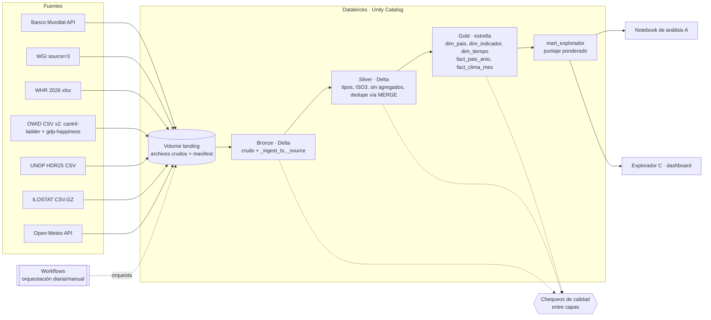

# 01 · Arquitectura de datos

## Diagrama

## Nombres reales (desde S1)

| Qué | Nombre |
|---|---|
| Catálogo Unity Catalog | `happiness` |
| Esquemas | `happiness.landing`, `happiness.bronze`, `happiness.silver`, `happiness.gold`, `happiness.meta` |
| Volume de archivos crudos | `happiness.landing.archivos` |
| Tabla de configuración | `happiness.meta.config_indicadores` (una fila por indicador evaluado, con `incluido` y `motivo`; no solo los que entran — queda de auditoría) |
| Repo GitHub | `bootcamp-felicidad-dataeng`, conectado como Databricks Repo |
| Notebook de setup | `00_setup.ipynb`, dentro del repo. Idempotente: `CREATE ... IF NOT EXISTS` + `MERGE` para la tabla de config |

El esquema `meta` es nuevo respecto al diagrama original: guarda tablas de control (config, y más adelante manifests de ingesta), separadas de los datos en sí.

## Organización de notebooks (desde S2; carpetas desde S5 — ver D19 y `claude/07_flujo_github.md`)

Un notebook por fuente y por capa, no un notebook gigante por capa. Convención de nombre: `<número>_<capa>_<fuente>`, donde `<fuente>` usa el mismo nombre que en `config_indicadores` y en los nombres de tabla Bronze, para que todo sea trazable con el mismo vocabulario. El número es solo el orden en que se fueron construyendo, no implica dependencia entre notebooks de una misma capa: cada uno de Bronze es independiente y se puede volver a correr solo.

Desde S5 (D19) estos notebooks viven en subcarpetas por capa dentro del repo (`00_setup/`, `bronze/`, `silver/`, `gold/`, `jobs/`), no todos sueltos en la raíz. El nombre del notebook no cambia al moverlo — el detalle de la reorganización y la convención de ramas/commits está en `claude/07_flujo_github.md`.

Dentro de un mismo notebook puede haber más de un `CREATE TABLE` cuando la fuente trae archivos con estructuras distintas (ver regla de abajo sobre OWID e ILOSTAT): cada `CREATE TABLE` sigue siendo independiente y re-corrible por separado, aunque compartan notebook.

| Notebook | Carpeta | Produce |
|---|---|---|
| `00_setup` | `00_setup/` | catálogo, esquemas, volume, tabla de config |
| `01_bronze_banco_mundial` | `bronze/` | `happiness.bronze.banco_mundial` (formato ancho, 1.498 indicadores sin filtrar — corregido en S3, ver D14) |
| `02_bronze_wgi` | `bronze/` | `happiness.bronze.wgi` |
| `03_bronze_whr` | `bronze/` | `happiness.bronze.whr` |
| `04_bronze_owid` | `bronze/` | `happiness.bronze.owid_cantril_ladder` + `happiness.bronze.owid_gdp_happiness` (dos tablas, no una — ver D12) |
| `05_bronze_undp` | `bronze/` | `happiness.bronze.undp` (formato ancho, ~1.076 columnas (1.115 con metadatos; 36 indicadores, 195 países + 11 agregados, ver `claude/08_hallazgos_eda_bronze.md`) `<indicador>_<anio>`) |
| `06_bronze_ilostat` | `bronze/` | `happiness.bronze.ilostat_luu` (LUU_2LU2_SEX_RT_A, 18.972 filas) + `happiness.bronze.ilostat_neet` (EIP_NEET_SEX_RT_A, 13.829 filas) — dos tablas, no una: mismo criterio que OWID, ver D16 |
| `07_bronze_open_meteo` | `bronze/` | `happiness.bronze.open_meteo` |
| *(más adelante)* `1x_silver_<fuente>` | `silver/` | una tabla Silver por fuente — acá es donde Banco Mundial y UNDP se despivotean (D14) |
| *(más adelante)* `2x_gold_...` | `gold/` | dimensiones y hechos del modelo estrella |

WGI es tabla Bronze separada de `banco_mundial` aunque ambos los publique el Banco Mundial: en `config_indicadores` ya se tratan como `fuente` distinta (`'WGI'` vs `'BANCO_MUNDIAL'`), y los archivos son estructuralmente distintos (ancho vs. largo). El mismo criterio aplica dentro de `04_bronze_owid` (S3, D12) y de `06_bronze_ilostat` (S4, D16): cuando dos archivos de una misma fuente no comparten exactamente las mismas columnas, van en tablas bronze separadas — para OWID eran columnas conceptualmente distintas (cantril-ladder vs gdp-vs-happiness); para ILOSTAT es que `EIP_NEET_SEX_RT_A` trae `note_indicator`/`note_source` y `LUU_2LU2_SEX_RT_A` no. En ambos casos, unir esas columnas (completando con `NULL` donde falten) es reconciliar esquemas distintos, y eso es trabajo de Silver, no de Bronze. Esto es distinto del caso de las 4 CSV de WGI (`wgi_va.csv`, `wgi_pv.csv`, `wgi_ge.csv`, `wgi_rl.csv`), que sí se leen juntas con un solo `read_files('wgi_*.csv')` porque comparten exactamente la misma estructura de columnas — ahí unir no es reconciliar esquemas, es leer varios archivos de una misma tabla.

Cuando una fuente tiene columnas con espacios, `:`, `+` u otros caracteres no válidos para nombres de columna en Delta (pasó con WHR y OWID en S3), la tabla bronze se crea con `TBLPROPERTIES ('delta.columnMapping.mode' = 'name', 'delta.minReaderVersion' = '2', 'delta.minWriterVersion' = '5')` y mantiene el nombre de columna original — no se renombra a snake_case (ver D13). Este patrón ya se usaba en WGI desde S2. (ILOSTAT en S4 no lo necesitó: sus columnas — `ref_area`, `source`, `indicator`, `sex`, `time`, `obs_value`, `obs_status`, `note_indicator`, `note_source` — son todas nombres válidos de Delta.)

Sobre tipos de columna en bronze (todas `STRING`, D10): el mecanismo para lograrlo depende del lector, y hay que declararlo explícito en el `read_files`/`spark.read` de cada notebook — no asumir un comportamiento por defecto sin probarlo. En este cluster, `read_files` con CSV **sí infiere tipos reales por defecto** (`inferColumnTypes` queda en `true`; quedaron columnas `double`/`int` en Banco Mundial, WGI, OWID y UNDP hasta que se detectó en S3 — ver D15). El fix es agregar `inferColumnTypes => false` dentro del `read_files(...)` de cada notebook CSV, para que la tabla nazca en `STRING` desde la lectura — nunca castear una tabla ya materializada como corrección posterior, porque eso dejaría el notebook mal escrito para la próxima vez que se re-corra. El lector nativo de Excel (WHR) es distinto: no tiene un flag equivalente, así que necesita `.schema(...)` explícito con todas las columnas `StringType` en la lectura misma (ver D11). ILOSTAT en S4 ya lo escribió bien desde el principio (`inferColumnTypes => false` desde el primer `read_files`, sin corrección retroactiva).

**Bronze nunca cambia la forma de los datos.** Ni `UNPIVOT` ni `PIVOT`, y tampoco filtra filas (ej. a una lista de indicadores elegidos): si el archivo fuente viene ancho, la tabla bronze queda ancha, con todos los indicadores/columnas que traiga, no solo los que el proyecto va a usar. `happiness.bronze.banco_mundial` violaba esto en la versión original de S2 (tenía un `UNPIVOT` y un filtro a 26 indicadores) — se corrigió en S3 (D14). El despivoteo y el filtrado de indicadores son trabajo de Silver.

## Capas

| Capa | Contenido | Reglas |
|---|---|---|
| landing | Archivo tal como llegó, más un manifest (url, fecha, hash, bytes) | Nunca se modifica. Un archivo por corrida. |
| bronze | Una tabla por fuente, columnas tal cual, más metadatos de ingesta | Append. Tolera schema drift (`mergeSchema`). **Sin cast de tipos: todas las columnas quedan `STRING` por construcción en la lectura** (`inferColumnTypes => false` en CSV, `.schema()` explícito en Excel — ver D10, D11, D15; nunca un cast posterior sobre la tabla ya cargada). **Sin cambiar la forma: sin `UNPIVOT`/`PIVOT`, sin filtrar filas/indicadores** (ver D14). Si una fuente trae el texto literal `"null"` se deja tal cual, no se convierte a `NULL` real (D10). El EDA de S6b verificó que Banco Mundial en realidad trae las celdas vacías como `NULL` real, y que WGI usa `..` solo en columnas por fuente que el proyecto no usa. Metadata real de ingesta (ver D17, corrige el diagrama original que mencionaba también `_batch_id`, nunca implementado): `_ingest_ts` (`current_timestamp()`) y `_source` — un string literal con el nombre del archivo cuando ese nombre es estable (ej. `'WDICSV.csv'` en Banco Mundial), o `_metadata.file_name` cuando el nombre de descarga varía entre corridas (ej. ILOSTAT, que lleva timestamp). Bronze es la base de auditoría: tiene que poder compararse carácter por carácter contra el archivo fuente. |
| silver | Tipos correctos, país a ISO3, agregados regionales fuera, nulos explícitos | MERGE por clave natural: reejecutar no duplica. Acá es donde se castea (`CAST`), se limpia el `"null"` string a `NULL` real, se despivotea lo que venga ancho (Banco Mundial, UNDP) y se filtra contra `config_indicadores`. |
| gold | Estrella y mart del explorador | Granularidad país-año (y país-mes para clima). |

## Modelo gold (estrella)

- `dim_pais(pais_key, iso3, nombre, region, grupo_ingreso)`
- `dim_indicador(indicador_key, codigo, nombre, tema, fuente, unidad)`
- `dim_tiempo(tiempo_key, anio, mes)`
- `fact_pais_anio(pais_key, indicador_key, anio, valor, valor_arrastrado, es_arrastre)`
- `fact_clima_mes(pais_key, anio, mes, temp_media, precipitacion, horas_sol)`
- `mart_explorador(pais_key, anio, puntaje_wlh, puntaje_ponderado)` (los pesos los pasa el usuario)

## Claves de diseño
- **Idempotencia:** en Bronze, Full Load (`CREATE OR REPLACE TABLE`) — reejecutar reemplaza la tabla entera, no duplica (no se usa `_batch_id`, ver D17). En Silver y Gold, `MERGE` por clave natural.
- **Trazabilidad:** de cualquier valor de gold se puede volver al archivo de landing.
- **Calidad:** chequeos mínimos por capa (filas > 0, claves únicas, rango de años, porcentaje de nulos por indicador). Si fallan, el Workflow se detiene.
- **Reproducibilidad:** parámetros (lista de indicadores, años) en una tabla/archivo de configuración, no en el código.

## Flujo de GitHub (ramas, commits, carpetas)

Ver `claude/07_flujo_github.md`: convención de ramas por sesión (`feature/sXX-capa-fuente` → PR → `main`, sin `develop`, D18), política de commits, y la estructura de carpetas del repo por capa (D19).
